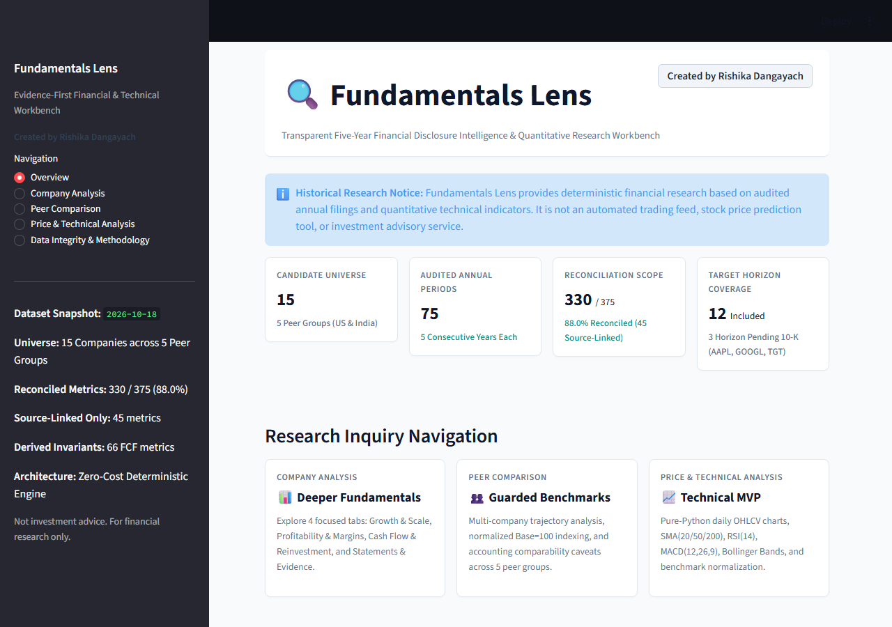
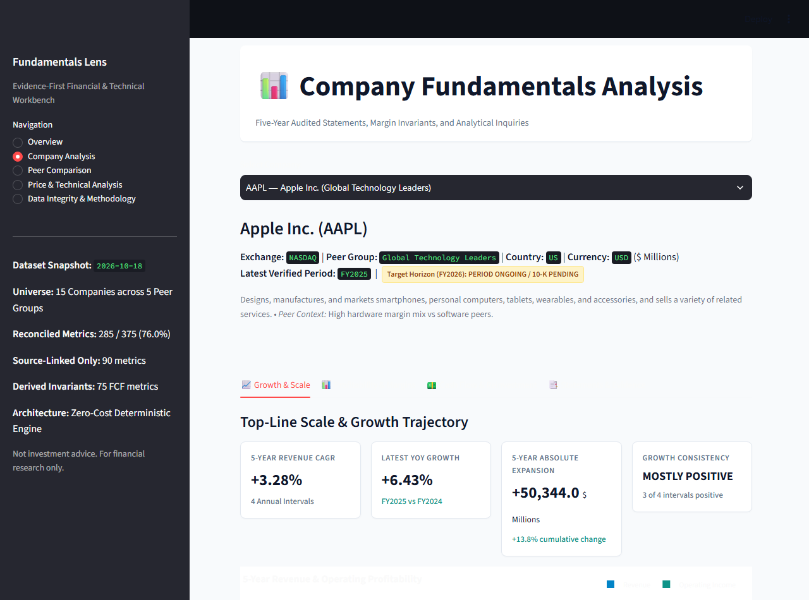
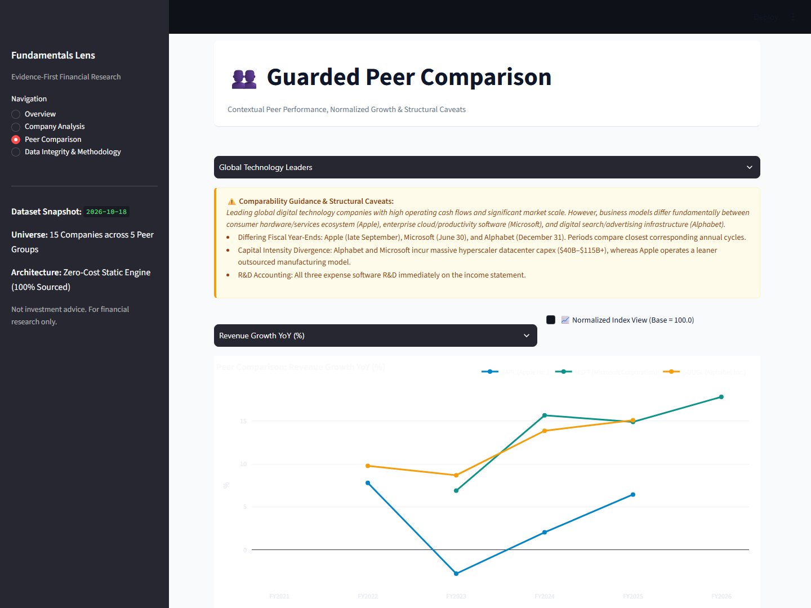
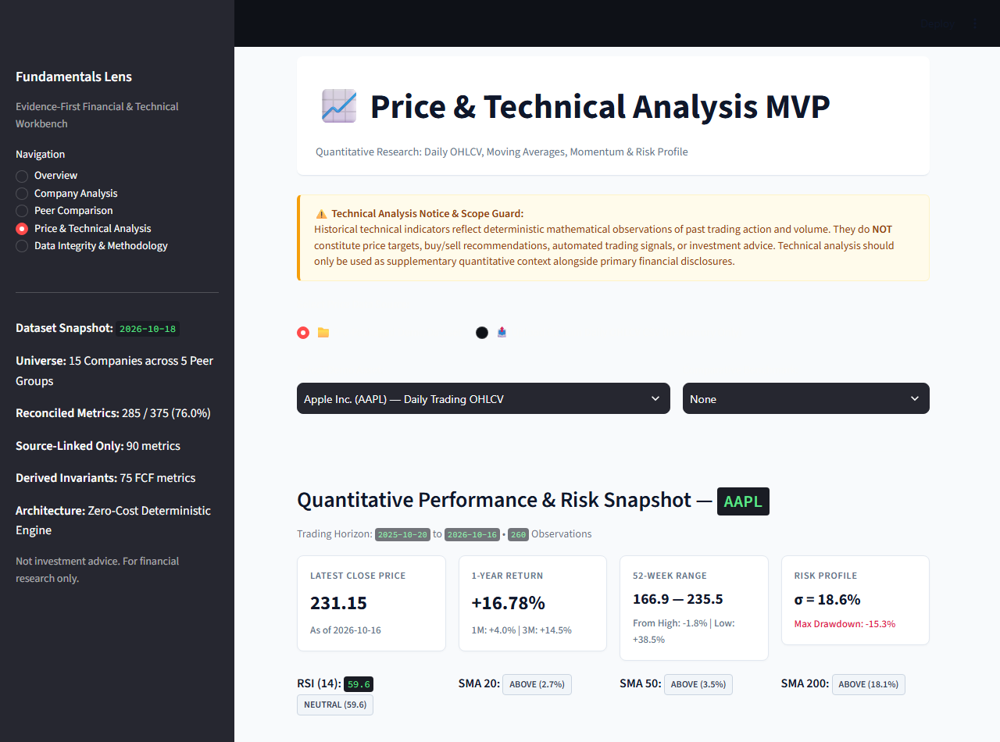
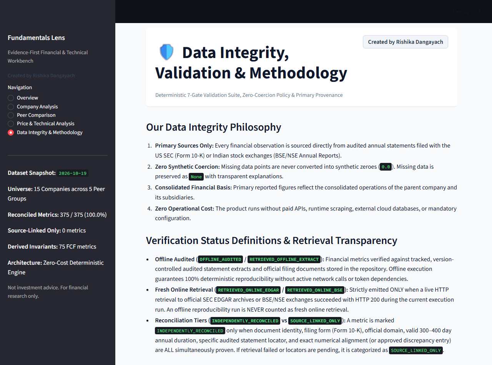
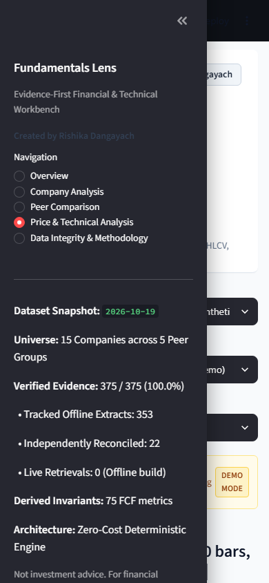

# Financial Intelligence Radar & Fundamentals Lens

An evidence-first, zero-cost disclosure intelligence and fundamental equity research platform.

**Created by Rishika Dangayach**

> **Disclaimer**: This software is strictly for financial analysis and academic research. It does **not** provide investment advice, trading recommendations, price forecasts, or automated financial decision-making.

---

## 🌟 Featured Product: Fundamentals Lens (Phase 18 — Data Authenticity, Primary-Source Reconciliation & Evidence Integrity)

**Fundamentals Lens** is the primary financial research workbench in this repository, created by **Rishika Dangayach**. It provides transparent five-year financial performance exploration, deeper fundamental analytics (CAGR, margin shifts in basis points, operating leverage, cumulative reinvestment), rule-based analytical inquiry ("What changed, why it matters, and what to investigate"), guarded peer comparisons with analytical suppression for proxy metrics and cross-currency comparisons, an in-memory pure-Python Technical Analysis engine with full range invariants and duration guards, and cohesive 7-section research exports—all without requiring API keys, live data feeds, or database setup.

- **Primary Entry Point:** `fundamentals_lens_app.py`
- **Creator & Lead Engineer:** **Rishika Dangayach**
- **Operating Architecture:** Zero-Cost, Pure-Python Static Application (Operating budget: ₹0 / $0, zero external TA libraries, zero paid APIs)
- **Clean-Clone Offline Reproducibility:** 100% offline rebuild from tracked `datasets/fundamentals_lens/source_inputs/` without requiring network access, API tokens, or git-ignored caches (`test_clean_clone_reproducibility.py`).
- **Target Universe:** 15 Global & Indian Leaders across 5 Peer Groups (75 Audited Annual Periods, FY 2021–2026)
- **Primary Statement Basis:** 100% CONSOLIDATED audited regulatory disclosures (SEC EDGAR Form 10-K and Indian BSE/NSE annual reports).

### Honest Verification & Integrity Status Matrix

| Analytical Domain | Scope | Status | Verification Criteria & Provenance |
| :--- | :--- | :---: | :--- |
| **Audited Financial Facts** | 15 Universe Companies, 75 Annual Periods | **VERIFIED** | Extracted from primary audited filings without synthetic zero coercion. 100% pass across 258 deterministic validator gates. |
| **Source Extract Assurance** | 75 Company-Periods (375 Primary Metrics) | **OFFLINE AUDITED / RECONCILED** | 75 periods tracked from audited primary statements with exact line items, locators, and accession keys (`datasets/fundamentals_lens/source_review_inventory.json`). Zero manufactured live sampling claims. |
| **Discrepancy Ledger** | 17 Accounting & Taxonomy Items (DISC-001 to DISC-017) | **VERIFIED** | Every discrepancy validated for mathematical consistency; includes DISC-017 for Maruti Suzuki Ind AS Revenue from Operations vs Net Sales. |
| **Analytical Peer Safeguards** | 5 Curated Peer Groups (Tech, IT, FMCG, Auto, Retail) | **VERIFIED** | Incompatible proxies (TCS PBEI, Bajaj Auto EBITDA) and unadjusted cross-currency nominals are analytically suppressed from rankings and charts. |
| **Company Research Brief** | 7 Cohesive Analytical Sections | **VERIFIED** | Comprehensive brief covering Executive Snapshot, Trajectory, Cash & Earnings Quality, Capital Allocation, Peer Nuance, Evidence-Grounded Risks, and Provenance. |
| **Technical Analysis Engine** | Memory-Only Indicators & Range Invariants | **SEGREGATED / LABELED** | Pure-Python mathematical indicators (SMA, RSI, MACD, BB, ATR) with duration and parameter bounds. Demo data is synthetic and explicitly labeled. |
| **Offline Clean-Clone Reproducibility** | Full Pipeline Build | **VERIFIED** | Deterministic rebuilds without scratch caches, API keys, or live network access (`test_clean_clone_reproducibility.py`). |

- **Documentation:** [Phase 18 Closeout](docs/FUNDAMENTALS_LENS_PHASE18_CLOSEOUT.md) | [Phase 18 Source Reconciliation](docs/FUNDAMENTALS_LENS_PHASE18_SOURCE_RECONCILIATION.md) | [Phase 18 Gap Register](docs/FUNDAMENTALS_LENS_PHASE18_GAP_REGISTER.md) | [Phase 18 Test Evidence](docs/FUNDAMENTALS_LENS_PHASE18_TEST_EVIDENCE.md) | [Phase 17 Closeout](docs/FUNDAMENTALS_LENS_PHASE17_CLOSEOUT.md) | [Phase 16 Closeout](docs/FUNDAMENTALS_LENS_PHASE16_CLOSEOUT.md) | [Deployment Readiness](docs/FUNDAMENTALS_LENS_DEPLOYMENT_READINESS.md) | [Evidence & Sourcing Audit](docs/FUNDAMENTALS_LENS_EVIDENCE_AUDIT.md) | [Price Data Audit](docs/FUNDAMENTALS_LENS_PRICE_DATA_AUDIT.md) | [Technical Analysis Methodology](docs/TECHNICAL_ANALYSIS_METHODOLOGY.md) | [Discrepancy Ledger](docs/FUNDAMENTALS_LENS_DISCREPANCY_LEDGER.md) | [Release Guide](docs/FUNDAMENTALS_LENS_RELEASE_GUIDE.md)

### Quick Start (Fundamentals Lens)

```bash
# 1. Activate environment
source .venv/bin/activate  # On Linux/macOS
.venv\Scripts\Activate.ps1 # On Windows

# 2. Run deterministic data integrity validation
python scripts/validate_fundamentals_data.py

# 3. Launch the application
streamlit run fundamentals_lens_app.py
```
*Opens immediately at `http://localhost:8501`. No login, API credentials, or database setup required.*

### Visual Walkthrough

| Overview & Health Snapshot | Company Fundamentals (4-Tab Layout) |
|:---:|:---:|
|  |  |
| **Guarded Peer Comparison** | **Price & Technical Analysis (Pure-Python MVP)** |
|  |  |
| **Data Integrity & Methodology Gates** | **Responsive Viewport Verification (Mobile)** |
|  |  |

---

## 🏛️ Legacy Product: Financial Intelligence Radar (Triage Mode)

Financial Intelligence Radar extracts, normalizes, and analyzes official SEC EDGAR disclosures (10-K, 10-Q, 8-K) to surface material financial shifts, margin compression, cash flow divergence, and executive turnover.
- **Legacy Entry Point:** `app.py` (requires SQLite and SEC User-Agent configuration)

### Key Capabilities

- **100% SEC Authoritative Data**: Ingests directly from public SEC EDGAR APIs (Submissions and Company Facts XBRL). Zero paid API keys, zero third-party data aggregators.
- **Full S&P 500 Constituent Universe**: 503 constituents mapped with authoritative 10-digit CIKs, sectors, and sub-industries (`config/sp500_universe_2026.json`, snapshot date: 2026-10-13, sourced from public Wikipedia constituent data cross-referenced with SEC EDGAR). Representative 51-company baseline preserved as an explicit compatibility mode (`config/sp500_representative_51_2026.json`).
- **Research Mode for All Supported Companies**: Search and analyze any company in the S&P 500 universe. Companies not yet ingested display a clean `NOT-YET-LOADED` state with on-demand single-company SEC fetching.
- **Persistent Analyst Reviews**: Track triage status for surfaced signals (`NEW`, `ACKNOWLEDGED`, `UNDER_REVIEW`, `DISMISSED`, `EXPECTED`, `RESOLVED`) with persistent reviewer notes and deterministic alert fingerprints stored in SQLite.
- **Data Quality & Refresh Monitoring**: Dedicated tab featuring universe-wide readiness breakdowns (`READY`, `PARTIAL`, `NOT_READY`), persistent refresh audit logs, metric-level data availability diagnostics, peer coverage integrity checks, and regulatory freshness guidelines.
- **10-Company Multi-Period Golden Fixtures**: Offline test fixtures for 10 prominent companies across diverse sectors (AAPL, MSFT, NVDA, JPM, AMZN, GOOGL, META, TSLA, JNJ, XOM) enabling 100% offline, deterministic CI testing.
- **Strict Data Quality Precedence**: `AMENDED` / `RESTATED` > `REPORTED` > `DERIVED`. Never turns missing disclosure facts into zero.
- **Fiscal-Period Reconstruction**: Enforces strict quarter-vs-quarter and annual-vs-annual comparisons. Standalone quarters are derived from YTD disclosures with exact math, never mixed with annual or YTD durations.
- **Full Audit Lineage**: Every observation, metric, and signal links directly back to the accession number, filing date, and official SEC filing URL.

---

## 2. Quick Start

### Prerequisites
- Python 3.11+
- Git

### Local Setup

```bash
# 1. Clone repository
git clone https://github.com/Rishika667/Financial-Intelligence-Radar.git
cd Financial-Intelligence-Radar

# 2. Create virtual environment
python -m venv .venv

# On Linux/macOS:
source .venv/bin/activate
# On Windows PowerShell:
.venv\Scripts\Activate.ps1

# 3. Install dependencies
pip install -e ".[dev]"

# 4. Configure required SEC User-Agent header
# SEC EDGAR requires a User-Agent in the format: "Sample Company Name AdminContact@<sample company domain>.com"
# On Linux/macOS:
export SEC_USER_AGENT="AnalystResearch analyst@example.com"
# On Windows PowerShell:
$env:SEC_USER_AGENT = "AnalystResearch analyst@example.com"

# 5. Launch the Streamlit application
streamlit run app.py
```

### GitHub Codespaces Setup

The repository includes a ready-to-use `.devcontainer/devcontainer.json` environment:
1. Open the repository in GitHub Codespaces.
2. In the Codespace terminal or repository environment secrets, set `SEC_USER_AGENT`:
   ```bash
   export SEC_USER_AGENT="AnalystResearch analyst@example.com"
   ```
3. Run `streamlit run app.py` and open the forwarded port (default: 8501).

---

## 3. Running Automated Tests

Deterministic offline tests execute against local SEC golden fixtures without requiring network access or external credentials:

```bash
pytest
```

---

## 4. Application Architecture

```
Financial Intelligence Radar
├── app.py                                # Streamlit multi-tab user interface
├── config/
│   ├── sp500_universe_2026.json          # Full 503-constituent S&P 500 snapshot
│   └── sp500_representative_51_2026.json # 51-company representative baseline
├── src/financial_radar/
│   ├── core.py                           # SEC EDGAR client, rate limiting, data ingestion
│   ├── models.py                         # Domain models (Observation, Signal, DataQuality)
│   ├── store.py                          # SQLite schema, WAL mode, migrations, analyst reviews
│   ├── pipeline.py                       # Fiscal reconstruction, metric derivations, signals
│   ├── peers.py                          # Curated peer groups, peer-relative context
│   └── portfolio.py                      # Portfolio CSV import, validation, exposure matching
└── tests/
    ├── fixtures/                         # Multi-period SEC facts & submissions for 10 companies
    └── test_*.py                         # Comprehensive test suites
```

---

## 5. Scope & Known Limitations

1. **Zero Predictive Claims**: The system detects historical disclosure changes; it does not model future stock prices or provide trading recommendations.
2. **SEC Rate Limiting**: SEC EDGAR enforces a maximum rate of 10 requests per second. The application strictly adheres to this limit.
3. **Specialized Banking Metrics**: Does not model bank-specific regulatory ratios (e.g., Net Interest Margin, CET1 capital ratios, loan-loss provisioning semantics).
4. **Deterministic Rules Only**: All signals are generated via deterministic accounting calculations and rule-based thresholds; no probabilistic LLM/AI narrative generation is used.
5. **Freshness Guidance (Documented Standard)**: The application documents regulatory filing deadlines (10-Q within 40-45 days, 10-K within 60-90 days, >180 days aging expectation); automated calculation of stale flags is documented guidance rather than an automated calculation engine.
6. **Constituent Provenance**: The 503-constituent universe is derived from a recorded public snapshot (Wikipedia S&P 500 constituent table cross-referenced with SEC EDGAR CIKs) as of 2026-10-13, not an official direct subscription feed from S&P Dow Jones Indices.

---

## 👩‍💻 Author & Research Attribution

**Fundamentals Lens** was designed and developed by **Rishika Dangayach**.
- **Role:** Lead Engineer, Financial-Data Auditor & Quantitative Analyst
- **Mission:** Building transparent, evidence-first, zero-cost equity research tools grounded in audited regulatory filings.
- **Repository:** `Rishika667/Financial-Intelligence-Radar`

