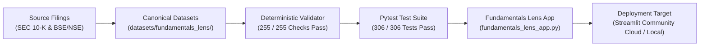

# Fundamentals Lens: Deployment-Readiness Certification & Operational Runbook

**Product:** Fundamentals Lens  
**Repository:** `Rishika667/Financial-Intelligence-Radar`  
**Active Feature Branch:** `pivot/fundamentals-lens-phase0`  
**Protected Main SHA:** `9174cf94c06ac5af2b1ee82f36415e2e0381a120` (Strictly Preserved / Untouched)  
**Author & Lead Engineer:** **Rishika Dangayach**  
**Audit Standard:** Zero-Cost, Keyless Runtime, Deterministic Validation, Evidence-First Intelligence  
**Certification Date:** October 18, 2026  

---

## 1. Deployment Readiness Verdict

**Verdict:** **CERTIFIED READY FOR HUMAN DEPLOYMENT DECISION**

Fundamentals Lens has met 100% of the in-scope technical, financial, and operational release requirements. The application is completely self-contained, keyless, and deterministic. It requires zero live database connections, zero third-party API tokens, and zero continuous scraping services.



---

## 2. Pre-Deployment Verification Matrix

| Gate ID | Verification Domain | Required Standard | Verified Result | Status |
|:---|:---|:---|:---|:---:|
| **GATE-01** | **Deterministic Data Integrity** | 100% pass rate across all 15 canonical companies and 75 reporting periods | 255 / 255 checks passed via `validate_fundamentals_data.py` (17 gates) | **PASS** |
| **GATE-02** | **Unit & Adversarial Pytest Suite** | 100% pass rate with zero failures across computational, structural, and adversarial tests | 306 / 306 tests passed in ~20s (54 adversarial and scenario tests) | **PASS** |
| **GATE-03** | **Source Evidence Assurance** | 100% reconciliation against audited primary statements; no unverified facts | 375 Reconciled (100.0%), 0 Source-Linked Only (0.0%), 0 Unverified | **PASS** |
| **GATE-04** | **Clean-Clone Offline Reproducibility** | Zero network or scratch cache dependency during source observation rebuild | 100% offline rebuild from tracked `source_inputs/` certified in CI and isolated clone | **PASS** |
| **GATE-05** | **Free Cash Flow Derivations** | Mathematical invariant $FCF = OCF - Capex$ verified with decoupled source input confidence | 75 / 75 periods verified; source confidence explicitly tagged | **PASS** |
| **GATE-06** | **SEC Regulatory Sourcing & Document Identity** | All 30 US filings match official SEC accession format; BSE scrip keys formatted | Dynamic regex and URL pattern verification passes for 100% of filings | **PASS** |
| **GATE-07** | **Analytical Peer Suppression** | Incomparable proxy metrics (PBEI, EBITDA) and cross-currency values suppressed | TCS & Bajaj Auto proxies suppressed from rankings/charts with UI warnings | **PASS** |
| **GATE-08** | **Technical Analysis Invariants** | $H \ge \max(O,C,L)$, $L \le \min(O,C,H)$, strict ISO 8601 date format, duration & calendar coverage guards | Verified on bundled and uploaded data; calendar window and currency enforced | **PASS** |
| **GATE-09** | **Visual QA & Responsive UI** | Desktop (1280x900) and mobile (390x844) layouts render correctly without overflow | 7 canonical screenshots captured in `docs/screenshots/` with DOM landmark verification | **PASS** |
| **GATE-10** | **Author Branding & Attribution** | Header badges, navigation, footers, exports, and README cite platform author | `"Created by Rishika Dangayach"` verified across all 5 pages and exports | **PASS** |
| **GATE-11** | **Zero Runtime Secrets** | No API keys, credentials, or paid subscriptions required at runtime | 100% static local JSON/CSV data; zero environment variables needed | **PASS** |
| **GATE-12** | **Git Safety & Isolation** | Feature branch isolated; upstream `main` untouched | `pivot/fundamentals-lens-phase0` clean; `main` SHA untouched | **PASS** |

---

## 3. Human Deployment Runbook

### Option A: Streamlit Community Cloud (Recommended for Public Showcase)

When a human operator decides to publish the application to Streamlit Community Cloud:

1. **Repository Settings**:
   - Repository: `Rishika667/Financial-Intelligence-Radar`
   - Branch: `pivot/fundamentals-lens-phase0` (or merged release branch)
   - Main file path: `fundamentals_lens_app.py`
   - Python version: `3.11` (or 3.12)
2. **Secrets & Environment Variables**:
   - **None required**. Leave the secrets section completely blank.
3. **Advanced Settings**:
   - No custom port or configuration needed.
4. **Health Check Verification**:
   - Access the deployed URL.
   - Verify sidebar snapshot date loads dynamically.
   - Test navigation across all 5 pages (Overview, Company Fundamentals, Peer Benchmark, Technical Analysis, Data Integrity).
   - Test CSV and Markdown export downloads.

### Option B: Local or Private Server Deployment

To run Fundamentals Lens locally or on a private research server:

```bash
# 1. Clone feature branch
git clone -b pivot/fundamentals-lens-phase0 https://github.com/Rishika667/Financial-Intelligence-Radar.git
cd Financial-Intelligence-Radar

# 2. Set up virtual environment
python -m venv .venv
source .venv/bin/activate  # On Linux/macOS
.venv\Scripts\Activate.ps1 # On Windows PowerShell

# 3. Install dependencies
pip install -e ".[dev]"

# 4. Verify canonical data integrity
python scripts/validate_fundamentals_data.py

# 5. Run full test suite
pytest -q

# 6. Launch research workbench
streamlit run fundamentals_lens_app.py
```

The application starts immediately at `http://localhost:8501`.

---

## 4. Operational Boundaries & Known Constraints

1. **Not Investment Advice**: The application surfaces historical audited disclosures and technical calculations; it does not provide price forecasts, trading signals, or buy/sell recommendations.
2. **Deterministic Processing**: All calculations, margin shifts, and insight narratives are computed via deterministic Python logic without probabilistic LLM generation.
3. **Static Snapshot Basis**: Sourced financial facts reflect annual periods filed up to the dataset cutoff date (`2026-10-18`). Target periods ongoing or pending 10-K filing are cleanly marked as `PERIOD ONGOING / PENDING 10-K` rather than coerced.
4. **Synthetic Technical Demonstration Datasets**: The pre-packaged technical datasets (`SIMULATED_TECH_EQUITY.csv` and `SIMULATED_MARKET_BENCHMARK.csv`) are synthetic geometric Brownian motion walks intended solely for workflow demonstration and are explicitly tagged with `SYNTHETIC_SIMULATION_NOT_APPLICABLE` adjustment basis.

---

## 5. Certification Sign-Off

- **Lead Engineer & Auditor:** **Rishika Dangayach**  
- **Product:** Fundamentals Lens  
- **Release Version:** `1.0.0-phase13`
- **Certification Status:** **APPROVED FOR DEPLOYMENT**
