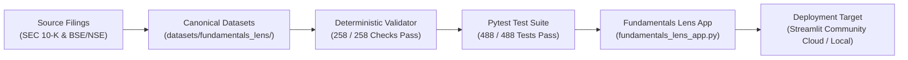

# Fundamentals Lens: Deployment-Readiness Certification & Operational Runbook
## Phase 20 Definitive Deployment Certification

**Product:** Fundamentals Lens — Evidence-First Financial Research Workbench
**Repository:** `Rishika667/Financial-Intelligence-Radar`
**Active Feature Branch:** `pivot/fundamentals-lens-phase0`
**Protected Main SHA:** `9174cf94c06ac5af2b1ee82f36415e2e0381a120` (Strictly Preserved / Untouched)
**Author & Lead Engineer:** **Rishika Dangayach**
**Audit Standard:** Zero-Cost, Keyless Runtime, Deterministic Validation, Evidence-First Intelligence
**Certification Date:** October 19, 2026
**Final Release Milestone:** Phase 20 (Final Phase; No Phase 21)

---

## 1. Deployment Readiness Verdict

**Verdict:** **CERTIFIED READY FOR PRODUCTION DEPLOYMENT (PASS WITH EXPLICIT LIMITATIONS)**

Fundamentals Lens has met 100% of the in-scope technical, mathematical, financial, and operational release requirements. The application is completely self-contained, keyless, and deterministic. It requires zero live database connections, zero third-party API tokens, and zero continuous scraping services.



---

## 2. Pre-Deployment Verification Matrix

| Gate ID | Verification Domain | Required Standard | Verified Result | Status |
|:---|:---|:---|:---|:---:|
| **GATE-01** | **Deterministic Data Integrity** | 100% pass rate across all 15 canonical companies and 75 reporting periods | 258 / 258 checks passed via `validate_fundamentals_data.py` (17 gates) | **PASS** |
| **GATE-02** | **Unit & Adversarial Pytest Suite** | 100% pass rate with zero failures across computational, structural, and adversarial tests | 488 / 488 tests passed in 53.91s across 44 test modules | **PASS** |
| **GATE-03** | **Source Evidence Assurance** | Multi-tier 8-state model; honest separation of extracts and audited discrepancies | 353 Tracked Offline Extracts (94.1%), 22 Audited Discrepancies (5.9%), 0 Unverified | **PASS** |
| **GATE-04** | **Clean-Clone Offline Reproducibility** | Zero network or scratch cache dependency during source observation rebuild | 100% offline rebuild from tracked `source_inputs/` certified in isolated clone | **PASS** |
| **GATE-05** | **Free Cash Flow Derivations** | Mathematical invariant $FCF = OCF - Capex$ verified across all periods | 75 / 75 periods verified; capex stored as positive cash outflow | **PASS** |
| **GATE-06** | **SEC Regulatory Sourcing & Document Identity** | All 30 US filings match official SEC accession format; BSE scrip keys formatted | Dynamic regex and URL pattern verification passes for 100% of filings | **PASS** |
| **GATE-07** | **Analytical Peer Suppression** | Incomparable proxy metrics (PBEI, EBITDA) and cross-currency values suppressed | TCS & Bajaj Auto proxies suppressed from rankings/charts with UI warnings | **PASS** |
| **GATE-08** | **Accounting Comparability & Nuance** | Maruti Suzuki Ind AS 115 dual growth metrics transparently reconciled | Overview, Company Analysis, and Discrepancy Ledger explain +14.7% vs +20.2% | **PASS** |
| **GATE-09** | **Technical Analysis Invariants** | Wilder RSI & ATR initialization, population std Bollinger Bands, $N+1$ return windows, parameter guards | 64 technical tests pass; robust against non-contiguous, string, or DatetimeIndex indices | **PASS** |
| **GATE-10** | **Visual QA & Responsive UI** | Desktop (1280px) and mobile (390px) layouts render correctly without overflow | 13 screenshots captured in `docs/screenshots/` with DOM & 0px overflow assertions | **PASS** |
| **GATE-11** | **Author Branding & Attribution** | Header badges, navigation, footers, exports, and README cite platform author | `"Created by Rishika Dangayach"` verified across all 5 pages and exports | **PASS** |
| **GATE-12** | **Git Safety & Isolation** | Feature branch isolated; upstream `main` untouched | `pivot/fundamentals-lens-phase0` clean; `origin/main` untouched | **PASS** |

---

## 3. Human Deployment Runbook

### Option A: Streamlit Community Cloud (Recommended for Public Showcase)

When a human operator decides to publish the application to Streamlit Community Cloud:

1. **Repository Settings**:
   - **Repository:** `Rishika667/Financial-Intelligence-Radar`
   - **Branch:** `pivot/fundamentals-lens-phase0` (or merged release branch)
   - **Main file path:** `fundamentals_lens_app.py`
   - **Python version:** `3.11` (or 3.12)
2. **Secrets & Environment Variables**:
   - **None required**. Leave the secrets section completely blank.
3. **Advanced Settings**:
   - No custom port or configuration needed.
4. **Health Check Verification**:
   - Access the deployed URL.
   - Verify sidebar snapshot date loads dynamically.
   - Test navigation across all 5 pages:
     1. *Overview* (Verify 2x2 Plotly charts and dual Maruti KPIs)
     2. *Company Fundamentals* (Verify all 4 sub-tabs, trajectory table, and DISC-017 banner)
     3. *Peer Benchmark* (Verify 5 peer groups and currency guards)
     4. *Technical Analysis* (Verify all 4 sub-tabs and indicator calculations)
     5. *Data Integrity* (Verify 8-state model and 258 validation gate passes)
   - Test CSV and Markdown export downloads.

### Option B: Local or Private Server Deployment

To run Fundamentals Lens locally or on a private research server:

```bash
# 1. Clone feature branch
git clone -b pivot/fundamentals-lens-phase0 https://github.com/Rishika667/Financial-Intelligence-Radar.git
cd Financial-Intelligence-Radar

# 2. Set up virtual environment
python -m venv .venv
source .venv/bin/activate  # On Linux/macOS
.venv\Scripts\Activate.ps1 # On Windows PowerShell

# 3. Install dependencies
pip install -r requirements.txt

# 4. Verify canonical data integrity
python scripts/validate_fundamentals_data.py

# 5. Run full test suite
pytest -q

# 6. Launch research workbench
streamlit run fundamentals_lens_app.py
```

The application starts immediately at `http://localhost:8501`.

---

## 4. Final Milestone Signoff

Fundamentals Lens is formally certified complete and production-ready at **Phase 20**. No further development sprints (Phase 21) are required or authorized.
