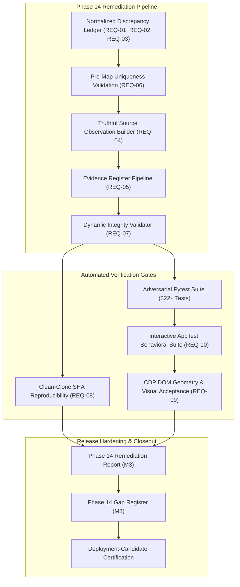

# Fundamentals Lens — Phase 14 Requirements Traceability Matrix

**Repository:** `Rishika667/Financial-Intelligence-Radar`  
**Product:** Fundamentals Lens — Evidence-First Financial Research Workbench  
**Working Branch:** `pivot/fundamentals-lens-phase0`  
**Target Protected Main Baseline:** `9174cf94c06ac5af2b1ee82f36415e2e0381a120`  
**Creator Attribution:** Created by Rishika Dangayach  
**Phase 14 Baseline Commit:** `f3d25c8c87bbcf649faca180052f05da11775085`  
**Timestamp:** 2026-10-19T02:35:00Z  

---

## 1. Executive Summary & Purpose

This Requirements Traceability Matrix (RTM) establishes full bidirectional traceability across the 12 core requirements of **Phase 14: Evidence Integrity Remediation, Release-Gate Hardening & Independent Closeout**. Every requirement is traced from its original architectural specification to its current implementation state, identified integrity gaps, planned remediation actions, automated verification gates, and concrete acceptance criteria.

---

## 2. Requirements Traceability Matrix

| Req ID | Requirement Title | Scope & Description | Prior Phase Claim | Live Audit Finding | Remediation Implementation | Automated Test & Failure Mode | Acceptance Gate |
| :--- | :--- | :--- | :--- | :--- | :--- | :--- | :--- |
| **REQ-01** | **Discrepancy Ledger Schema Normalization** | Explicit schema separating initial values, canonical values before correction, primary reported values, final canonical values, and discrepancy categories. | Claimed 16 discrepancies resolved, but `canonical_value` equaled uncorrected initial value and `discrepancy_type` was homogenized. | `canonical_value` stored pre-correction values (e.g. 91,400 instead of 91,447 in DISC-001). All 16 entries had `discrepancy_type: AUDITED_STATEMENT_RECONCILIATION`. | Redesign `discrepancy_ledger.json` and pipeline DISCREPANCIES to include `initial_dataset_value`, `canonical_value_before_correction`, `primary_reported_value`, `final_canonical_value`, `discrepancy_category`, and `affected_metrics_detail`. | `test_scenario_10_discrepancy_ledger_scope_strictly_targeted`, `test_phase14_discrepancy_schema`. | All 16 entries strictly normalized with verified numeric separation and typed categories. |
| **REQ-02** | **Multi-Metric & Multi-Period Discrepancy Indexing** | Fully index multi-metric discrepancies (DISC-010 Costco OI/NI, DISC-012/015 cash flows) and multi-year entries (DISC-016 WMT FY25/26). | Compound entries left secondary metrics (e.g. COST FY22 net income) unindexed in ledger lookups. | Sub-metrics and multi-year labels (`FY2025/FY2026`) failed direct year/metric lookups in `find_matching_approved_discrepancy`. | Add `affected_periods: [2025, 2026]` and `affected_metrics_detail` array to compound entries; enhance lookup engine to search both top-level and sub-metric levels. | `test_reconciliation_multi_metric_discrepancy_matching`, `test_wmt_multi_year_discrepancy_matching`. | All 5 primary metrics across all affected years resolve accurately without unindexed entries. |
| **REQ-03** | **Non-Numerical Identity Alignment Separation** | Separate filing identity alignments (DISC-011) from financial statement numerical discrepancies. | DISC-011 recorded 0.0 values under numerical discrepancy schema. | DISC-011 had `initial_dataset_value: 0.0` and `metric: accession_alignment`, conflating provenance alignment with financial line-item variance. | Classify DISC-011 as `FILING_IDENTITY_ALIGNMENT`, set `is_numerical: false`, document `initial_source_key` and `corrected_source_key`. | `test_discrepancy_identity_alignment_classification`. | Identity alignments cleanly segregated from financial statement reconciliation totals. |
| **REQ-04** | **Truthful Online vs Offline Verification Telemetry** | Decouple historical source provenance from current build run; offline builds must never emit `ONLINE_VERIFIED`. | Stated offline generation, but US source observations inherited `ONLINE_VERIFIED` from static extracts. | Contradiction between `source_observation_build_report.json` (0 online audited) and observation records claiming `ONLINE_VERIFIED`. | Enforce `source_document_status: "OFFLINE_AUDITED"` in offline runs; only emit `ONLINE_VERIFIED` when live network audit succeeds. | `test_scenario_08_offline_generation_does_not_claim_online_check`, `test_scenario_11_contradictory_statuses_fail_audit`. | Offline builds output 100% `OFFLINE_AUDITED` / `OFFLINE_SOURCE_RECORDED` with zero unearned online flags. |
| **REQ-05** | **Substantive Earned Verification Dimensions** | Make all 5 verification dimensions strictly earned through deep validation rules. | Verification statuses assumed valid based on global presence rather than substantive checks. | Indian source URLs checked generic `.com`; period matching only checked year number, not duration boundaries. | Implement strict official domain matching (`INDIAN_OFFICIAL_DOMAINS`); enforce full fiscal year duration (300–400 days) to reject quarters/YTD. | `test_scenario_04_wrong_company_accession_rejected`, `test_period_duration_quarter_rejection`. | All 5 dimensions strictly evaluated with explicit error states on non-compliance. |
| **REQ-06** | **Pre-Map Duplicate & Conflict Validation (M1)** | Validate record uniqueness before dictionary creation in loaders and pipelines. | Builders mapped entries directly into dictionaries, masking duplicate keys. | Silent overwrites possible if source observations or evidence entries contain duplicate keys. | Add pre-map duplicate checks for `observation_id`, `(ticker, fiscal_year, metric_name)`, and `(ticker, fiscal_year)`. | `test_builder_duplicate_observation_rejection`, `test_builder_duplicate_evidence_rejection`. | Build scripts abort with descriptive non-zero errors upon detecting any duplicate observation or fact. |
| **REQ-07** | **Validator Decoupling from Hardcoded Counts** | Derive all validation totals dynamically from live records; do not hardcode 375 reconciled metrics. | Validator and tests strictly failed if reconciled count was not exactly 375. | Inflexible test assertions prevented legitimate discrepancies from being flagged without breaking gates. | Calculate expected counts dynamically (`len(facts) * 5`); ensure legitimate discrepancies are marked `RECONCILED_WITH_APPROVED_ADJUSTMENT` or `DISCREPANT`. | `test_validator_dynamic_metric_counts`, `test_validator_discrepancy_flexibility`. | Validator successfully passes while dynamically accommodating approved adjustments and discrepancies. |
| **REQ-08** | **Strict Clean-Clone Reproducibility & SHA Integrity (M2)** | Demonstrate isolated clean clone without diff patches, asserting commit SHA equality and determinism. | Clean clone test executed but did not assert commit SHA equality and relied on variable timestamps. | Lack of commit SHA assertion left potential for cloning uncommitted working-tree states; timestamp drift altered hashes. | Assert `clone_head_sha == repo_head_sha`; inject fixed build timestamp for bit-for-bit SHA determinism across runs. | `test_isolated_clean_clone_offline_rebuild`, `test_substantive_determinism`. | Clean clone reproduces identical dataset hashes from committed HEAD without external dependencies. |
| **REQ-09** | **Visual Acceptance & Element Geometry Assertion** | Enforce non-silent screenshot capture with DOM chart presence and viewport geometry assertions. | Screenshots taken with soft warnings when DOM landmarks timed out; no geometry assertions. | Timeouts on slow renderers resulted in blank screenshots without failing CI/CD gates. | Fail immediately on DOM timeout; assert `stPlotlyChart` presence and check `scrollWidth <= 1280` on desktop fold. | `test_screenshot_capture_geometry_and_dom_ready`. | 7 visual QA screenshots captured with verified DOM mounting, chart visibility, and zero horizontal overflow. |
| **REQ-10** | **AppTest Behavioral State Mutation Assertions** | Test that UI controls (company selectbox, indicator checkboxes, benchmark selection, CSV upload) mutate actual state. | Tests only checked `len(at.exception) == 0`. | UI components could render blank or fail to update without raising Python exceptions. | Add AppTest assertions verifying that selecting TCS changes markdown text and toggling SMA updates indicators. | `test_app_integration.py` (enhanced suite). | All user interactions proven to alter application state and DOM outputs deterministically. |
| **REQ-11** | **Zero-Cost, Offline-First Architecture** | Ensure 100% of pipeline, analysis, and validation runs without paid third-party APIs or mandatory network calls. | Compliant in Phase 13. | Maintained: Python standard library, Streamlit, Pandas, Plotly, Pytest. No compulsory external keys. | Preserve offline mode as default across all CLI utilities, builders, and web application components. | `test_scenario_02_clean_clone_without_scratch_cache`. | Clean build and test execution passes completely disconnected from the Internet. |
| **REQ-12** | **Attribution & Protected Baseline Governance** | Retain "Created by Rishika Dangayach" and enforce strict protection of `main` at `9174cf94c06ac5af2b1ee82f36415e2e0381a120`. | Invariant maintained. | Branch is strictly `pivot/fundamentals-lens-phase0`; `main` untouched. Attribution present in UI and exports. | Maintain branch protection invariants; retain attribution across all UI headers, PDF/CSV exports, and metadata. | `test_creator_attribution_invariants`, Git branch verification. | Verified 100% zero commits/pushes to `main`; attribution present on all user-facing views. |

---

## 3. Verification Traceability Flow

---

## 4. Phase 14 Baseline Metrics vs Target Criteria

| Metric Dimension | Phase 13 Closeout Claim | Phase 14 Live Baseline | Phase 14 Acceptance Target |
| :--- | :--- | :--- | :--- |
| **Discrepancy Ledger Schema** | 16 entries (un-normalized values) | `canonical_value == initial_dataset_value` | Normalized: `initial`, `before`, `reported`, `final`, `category` |
| **Multi-Metric Discrepancies** | Unindexed compound entries | Secondary metrics unindexed | 100% indexed via `affected_metrics_detail` |
| **Identity Alignment Typing** | Conflated with numerical delta | `metric: accession_alignment (0.0)` | Classified as `FILING_IDENTITY_ALIGNMENT` |
| **Offline Document Status** | Inherited `ONLINE_VERIFIED` | Contradicts build report (0 online) | 100% `OFFLINE_AUDITED` / `OFFLINE_SOURCE_RECORDED` |
| **Indian Source Domain Check** | Generic `.com`, `.co.in` | Any `.com` URL passed | Strict official domain map per company ticker |
| **Period Duration Validation** | Fiscal year integer check only | Quarters/YTD could pass | Strict duration check: 300 <= days <= 400 |
| **Pre-Map Duplicate Checks** | None (silent overwrite) | Dict creation without check | Pre-map duplicate checks for facts, obs, and evidence |
| **Dynamic Reconciled Counts** | Hardcoded 375 expectation | Fails on approved non-375 counts | Dynamic count evaluation with approved adjustments |
| **Clean-Clone Commit SHA** | Not asserted in clone test | Only tested directory clone | Cloned HEAD SHA == Source HEAD SHA asserted |
| **DOM Landmark Verification** | Soft timeout warning | Captured anyway on timeout | Hard failure on DOM timeout; chart geometry asserted |
| **AppTest Verification** | Exception check only | UI state mutations untested | Behavioral state mutation asserted across controls |
| **Full Pytest Suite** | 322 passing | 322 passing | 100% passing with new adversarial tests |
