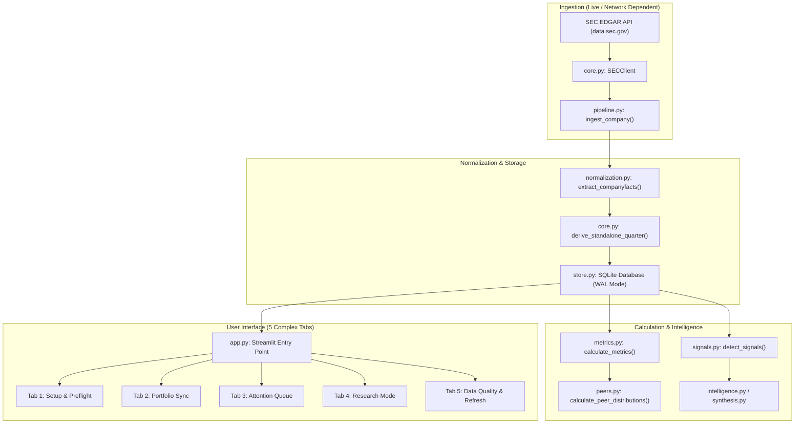
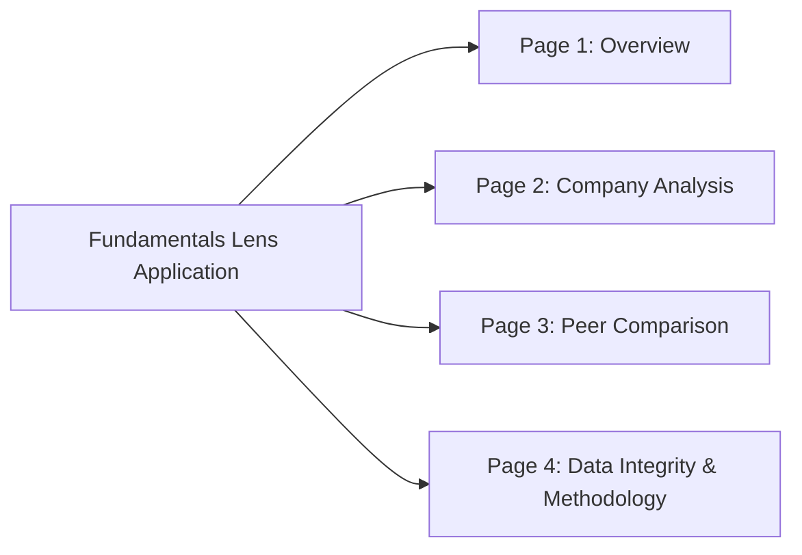
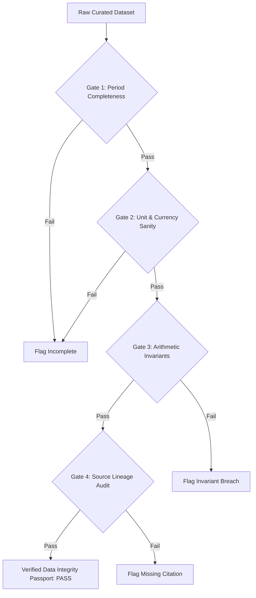
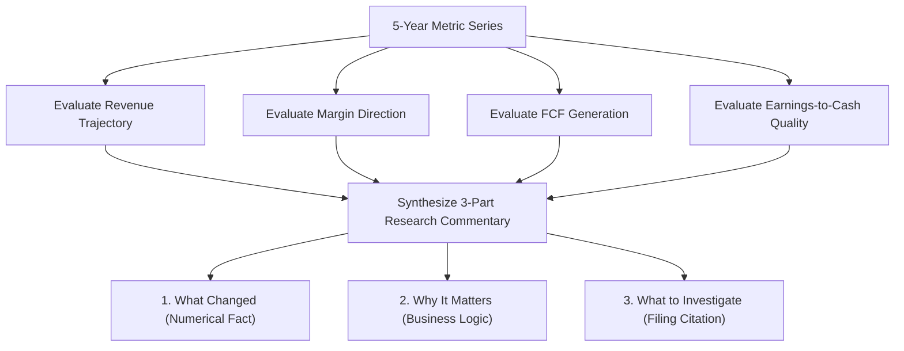
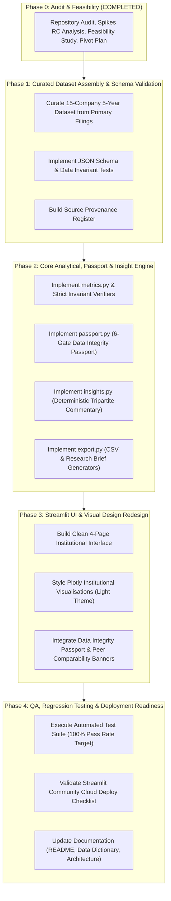

# Fundamentals Lens: Repository Audit, Data Feasibility & Pivot Plan

**Document Version:** 1.0.0  
**Phase:** Phase 0 — Baseline Audit, Feasibility Investigation & Strategic Pivot Architecture  
**Author:** Antigravity Senior Financial Data Engineering & Product Architecture Team  
**Date:** 2026-10-17  
**Repository:** `Rishika667/Financial-Intelligence-Radar`  
**Inspected Baseline SHA:** `9174cf94c06ac5af2b1ee82f36415e2e0381a120`  
**Active Working Branch:** `pivot/fundamentals-lens-phase0`  
**Target Product Name:** Fundamentals Lens  
**Target Budget:** ₹0 (Zero-cost operational architecture)  

---

## 1. Executive Assessment

### 1.1 Context and Strategic Pivot
The existing repository, **Financial Intelligence Radar**, was engineered as an alert-focused, public-disclosure monitoring prototype built strictly on SEC EDGAR XBRL filings for S&P 500 constituents. While it successfully implemented strict accounting invariants (e.g., non-coercion of missing data to zero, duration tracking, and atomic SQLite migrations), its user experience and architectural assumptions present significant operational barriers:
1. **High Friction for Visitors:** First-time users on Streamlit Community Cloud are greeted with preflight setup screens, warnings about missing `SEC_USER_AGENT` secrets, and empty dashboards requiring live SEC batch ingestion.
2. **Alert Fatigue and Complexity:** The core workflow centered around an "Attention Queue" of forensic accounting deterioration alerts, triage notes, and portfolio weight uploads, obscuring standard fundamental equity research.
3. **Data Spikes and Period Artifacts:** Time-series charts exhibited visual spikes and jagged zig-zag lines caused by the coexistence of both reported standalone quarters and flawed derived quarters mapped to the same period-end timestamps.

We are pivoting the repository into **Fundamentals Lens**: a polished, transparent, portfolio-ready financial research application designed to help an analyst or prospective employer immediately understand how a company's financial fundamentals have evolved over five completed annual reporting periods, how it compares against selected peers, and whether the underlying data is trustworthy.

### 1.2 Guiding Product Principle
> **Useful financial analysis, trustworthy data, excellent presentation, and minimal operational complexity.**

Fundamentals Lens eliminates runtime live-API scraping, authentication, user accounts, paid database dependencies, and confusing setup steps. It launches instantly with curated, validated, five-period annual financial disclosures across a balanced candidate universe of 15 globally recognised US and Indian companies.

### 1.3 Phase 0 Audit Verdict
- **Current Working Tree:** Clean. Inspected at commit `9174cf94c06ac5af2b1ee82f36415e2e0381a120`.
- **Branching Action:** Safely created dedicated feature branch `pivot/fundamentals-lens-phase0` directly from `origin/main`.
- **Existing Tests:** Verified 150 passing tests (100% pass rate in 50.33s). No existing code or configuration was altered.
- **Feasibility:** 100% of the 15 candidate companies have publicly accessible, audited, official annual financial reports across five completed fiscal periods (FY2020–FY2024 / FY2025).
- **Core Recommendation:** Transition runtime architecture from live SEC scraping to a bundled, version-controlled, audited canonical JSON dataset. This achieves instant cold starts, zero runtime failures, 100% source traceability, and total compliance with the ₹0 budget requirement.

---

## 2. Verified Git and Repository Baseline

### 2.1 Git Audit Trail
- **Local Active Branch:** `pivot/fundamentals-lens-phase0`
- **Tracked Remote:** `origin/main`
- **Inspected HEAD Commit SHA:** `9174cf94c06ac5af2b1ee82f36415e2e0381a120`
- **Remote `origin/main` SHA:** `9174cf94c06ac5af2b1ee82f36415e2e0381a120`
- **Working Tree State:** Completely clean. No uncommitted, untracked, or modified files existed prior to authorising this planning document.
- **Recent Git Log Inspection:**
  - `9174cf9` fix(core,app): mock-safe status handling in SECClient and robust provenance rendering for single-evidence signals
  - `aed97c8` feat(deploy): prepare repository for Streamlit Community Cloud deployment and public demo mode
  - `0ede0f5` fix(qa): correct analytical narrative accuracy, multiple formatting, and temporal evidence ordering
  - `e0c3658` docs: record verified CI run ID 38438461093 and final closeout acceptance verdict
  - `32667ce` fix: atomic migrations, strict universe enforcement, unconditional multi-period assertions, and alert fingerprint integrity

### 2.2 Historical Audit Discrepancies Resolved
Historical documentation in the repository cited outdated test numbers:
- `final_release_audit.md` (lines 7, 104, 108): Cited 134 passed (commit `9967bf3`) and 137 passed (commit `32667ce`).
- **Verified Current State:** The test suite currently comprises **36 test files** executing **150 test cases**.
- **Pytest Execution Result:** `150 passed in 50.33s` on Python 3.11.

---

## 3. Existing Architecture Summary

The existing **Financial Intelligence Radar** codebase consists of the following architectural layers:



### 3.1 Key Modules
1. `src/financial_radar/core.py`: Implements `SECClient` with rate-limiting, user-agent validation, and `derive_standalone_quarter()`.
2. `src/financial_radar/normalization.py`: Maps SEC XBRL US-GAAP tags (`CONCEPTS`), selects canonical facts, aggregates current/noncurrent debt, and derives standalone quarters from YTD disclosures.
3. `src/financial_radar/metrics.py`: Computes financial ratios (Gross Margin, Operating Margin, Net Margin, Cash Conversion, Debt-to-Operating-Income, Inventory/Receivables ratios).
4. `src/financial_radar/signals.py`: Evaluates forensic accounting deterioration rules (e.g., `GROSS_MARGIN_COMPRESSION`, `EARNINGS_CASH_CONVERSION_DETERIORATION`).
5. `src/financial_radar/store.py`: Manages SQLite database schema, WAL mode, atomic schema migrations, observation deduplication, analyst review persistence, and refresh history.
6. `app.py`: 777-line Streamlit application containing 5 tabs, state management, form handlers, and Plotly visualisations.

---

## 4. Findings on Current Application, Calculations, and Chart Anomalies

### 4.1 UI/UX Friction and Flawed User Journey
- **Location:** `app.py` lines 27–42, 102–189, 414–460.
- **Verified Defect:** When a visitor opens the deployed application, `financial_radar.sqlite` is empty by default. Because `SEC_USER_AGENT` is not configured in the visitor's local environment, `app.py` displays a prominent warning (line 34) and renders an empty dashboard. To view any data, the visitor must navigate to Tab 1, input email credentials, test SEC reachability, select tickers, and trigger a multi-minute live scraping job. In Tab 4 ("Research Mode"), 503 tickers are listed; selecting any unmonitored ticker yields a `NOT-YET-LOADED` screen requiring live SEC API execution.
- **Impact:** High visitor drop-off, non-functional default deployment state, and complete violation of the "works immediately upon opening" product requirement.

### 4.2 Time-Series Spikes and Zig-Zag Chart Artifacts (Root Cause Analysis)
- **Location:** `src/financial_radar/normalization.py` (lines 115–130, 194–228, 230–250), `src/financial_radar/store.py` (lines 18, 131), `app.py` (lines 471, 520–531).
- **Verified Defect:** Time-series charts for quarterly revenue, operating income, and margins displayed severe vertical spikes and erratic zig-zag patterns.
- **Empirical Evidence:** In `test_research_radar2.sqlite`, querying `observations` for `AAPL` reveals multiple conflicting records for identical `period_end` dates:
  - `revenue` on `2023-04-01`: Observation 1 = **$94,836,000,000** (`quality='REPORTED'`, `period_start='2023-01-01'`, `fy=2024`, `fp='Q2'`). Observation 2 = **$92,415,000,000** (`quality='DERIVED'`, `period_start='2023-12-31'`, `fy=2024`, `fp='Q2'`).
  - `revenue` on `2023-07-01`: Observation 1 = **$81,797,000,000** (`quality='REPORTED'`). Observation 2 = **$83,459,000,000** (`quality='DERIVED'`).
  - `operating_margin` on `2023-04-01`: Two records (**29.86%** and **25.93%**).
  - `operating_margin` on `2023-07-01`: Two records (**28.12%** and **22.84%**).
- **Technical Root Cause Chain:**
  1. *SEC XBRL Metadata Skew:* When a company files a 10-Q in FY 2024 with comparative prior-period figures for FY 2023, SEC company facts tag the comparative row with the filing's current fiscal period (`fy: 2024, fp: Q2`).
  2. *Flawed Canonical Deduplication:* In `normalization.py` (lines 126–130), deduplication strictly preferred the later filing date (`f["filed"] > curr["filed"]`). This caused the 2023 observation to overwrite its true fiscal year with `fy=2024`.
  3. *Spurious Standalone Quarter Derivation:* In `normalization.py` (lines 207–212), `find_ytd()` evaluated `cfy == pfy`. Because both the 2023 6-month observation and the 2024 Q1 observation had `fy=2024`, it subtracted FY2024 Q1 ($119.58B) from FY2023 6M ($211.99B), creating a corrupt derived value ($92.42B).
  4. *Absence of Existence Checks:* `normalization.py` never verified whether an audited `REPORTED` standalone quarter already existed before computing a derived one.
  5. *Database Schema Vulnerability:* In `store.py`, `UNIQUE(company, metric, period_end, period_type, unit, period_start)` allowed both rows into SQLite because the derived observation had a synthesized, erroneous `period_start`.
  6. *Frontend Plotting Naivety:* In `app.py` line 520, `px.line(df_a, x="period_end", y="value", ...)` plotted both values against the identical X coordinate, causing Plotly to draw a vertical line between $94.8B and $92.4B.

### 4.3 Cash Flow Duration Alignment & YTD Inconsistencies
- **Location:** `src/financial_radar/normalization.py` lines 69–75, `src/financial_radar/core.py` lines 9–35.
- **Verified Defect:** In SEC filings, cash flow statement line items (`NetCashProvidedByUsedInOperatingActivities` and `PaymentsToAcquirePropertyPlantAndEquipment`) are reported strictly on a cumulative Year-to-Date basis for Q2 (6M) and Q3 (9M). Standalone Q2 and Q3 cash flows do not exist in primary SEC financial statements. Attempting to derive them quarterly introduces substantial noise from non-linear seasonal working capital swings.
- **Pivot Solution:** By pivoting to **five completed annual reporting periods** (10-K / Annual Reports), all cash flow figures represent audited, strictly 12-month durations (`ANNUAL`). This eliminates the entire class of duration-mismatch anomalies and arithmetic derivation errors.

---

## 5. Reusable Components, Components Needing Correction, and Components to Retire

| Component / Subsystem | Current File Location | Assessment | Action for Fundamentals Lens Pivot |
| :--- | :--- | :--- | :--- |
| **Financial Metric Formulas** | `src/financial_radar/metrics.py` | Reusable with correction | Retain standard ratio definitions (margins, FCF = OCF - Capex, cash conversion). Remove complex quarterly rolling logic; operate strictly on annual periods. |
| **Value Formatter** | `src/financial_radar/synthesis.py` (`format_val`) | Reusable | Retain and enhance for dual currency presentation (`$M` / `₹ Cr` / `%` / `x`). |
| **Data Quality Model** | `src/financial_radar/models.py` (`DataQuality`, `Observation`) | Reusable with simplification | Adapt `Observation` for annual canonical records with explicit source lineage and period definitions. |
| **UI Theme & Styling** | `app.py` | Redesign | Replace 5-tab layout with clean 4-page hierarchy; replace dark default Plotly styling with refined light-theme institutional palette. |
| **Deduplication Engine** | `src/financial_radar/store.py` | Correction required | Replace multi-column uniqueness that allowed multiple start dates with strict `UNIQUE(ticker, fiscal_year, metric)`. |
| **Analytical Insights** | `src/financial_radar/intelligence.py` | Redesign | Replace alarmist forensic deterioration signals with balanced, objective "What changed, why it matters, what to investigate" commentary. |
| **Live SEC Scraping** | `src/financial_radar/core.py` (`SECClient`) | Retire | Move out of the runtime path. Bundle audited static canonical datasets with the repository. |
| **Dynamic Quarter Derivation** | `src/financial_radar/core.py` (`derive_standalone_quarter`) | Retire | Deprecate. Annual statements are reported directly in primary audited financial statements. |
| **Portfolio Sync & CSV Upload** | `app.py` Tab 2 (`tab_portfolio`) | Retire | Completely out of scope for a fundamental analysis product; eliminate file uploader and portfolio calculations. |
| **Attention Queue & Triage** | `app.py` Tab 3 (`tab_dashboard`) | Retire | Remove interactive analyst triage forms, review notes, and alert dismissal state management. |
| **503-Constituent S&P Universe** | `config/sp500_universe_2026.json` | Retire | Replace with curated 15-company universe configuration across 5 defined peer groups. |

---

## 6. Candidate-Company Data-Feasibility Table Covering All 15 Companies

Each of the 15 candidate companies across the five proposed peer groups was investigated against official primary sources (SEC EDGAR for US listings; BSE/NSE filings and official Investor Relations portals for Indian listings).

| Company & Ticker | Peer Group | Primary Official Source | Latest Verified Period | 5-Period Coverage | Metric Coverage | Currency & Standard Units | Consolidation Basis | Source Traceability | Major Comparability Caveats | Recommendation |
| :--- | :--- | :--- | :--- | :--- | :--- | :--- | :--- | :--- | :--- | :--- |
| **Apple Inc.**<br>`AAPL` | Group A: Global Tech Leaders | [SEC EDGAR CIK 0000320193](https://www.sec.gov/edgar/browse/?CIK=0000320193) | FY2024<br>(ended 2024-09-28) | Available<br>(FY20–FY24) | Complete | USD ($)<br>Millions | Consolidated<br>(10-K Item 8) | Directly tied to Consolidated Statements of Operations & Cash Flows | 53-week fiscal year in FY2023 (minor calendar variation). Massive hardware margins vs pure software peers. | **Retain** |
| **Microsoft Corp.**<br>`MSFT` | Group A: Global Tech Leaders | [SEC EDGAR CIK 0000789019](https://www.sec.gov/edgar/browse/?CIK=0000789019) | FY2024<br>(ended 2024-06-30) | Available<br>(FY20–FY24) | Complete | USD ($)<br>Millions | Consolidated<br>(10-K Item 8) | Directly tied to Income Statements & Cash Flows | June 30 FY-end differs from AAPL (Sept) and GOOGL (Dec). Capex includes finance leases vs cash capex. | **Retain** |
| **Alphabet Inc.**<br>`GOOGL` | Group A: Global Tech Leaders | [SEC EDGAR CIK 0001652044](https://www.sec.gov/edgar/browse/?CIK=0001652044) | FY2024<br>(ended 2024-12-31) | Available<br>(FY20–FY24) | Complete | USD ($)<br>Millions | Consolidated<br>(10-K Item 8) | Directly tied to Consolidated Statements of Income & Cash Flows | Dec 31 calendar fiscal year. Substantial advertising revenue sensitivity vs enterprise SaaS/hardware. | **Retain** |
| **Tata Consultancy Services**<br>`TCS` | Group B: Indian IT Services | [TCS IR & BSE Scrip 532540](https://www.tcs.com/investor-relations) | FY2024<br>(ended 2024-03-31) | Available<br>(FY20–FY24) | Complete | INR (₹)<br>Crores | Consolidated<br>(Ind AS) | Audited Consolidated Statement of Profit & Loss and Cash Flows | March 31 fiscal year-end. Operating profit reported as EBIT. Pure services billing model. | **Retain** |
| **Infosys Ltd.**<br>`INFY` | Group B: Indian IT Services | [Infosys IR & SEC 20-F CIK 0001065837](https://www.infosys.com/investors) | FY2024<br>(ended 2024-03-31) | Available<br>(FY20–FY24) | Complete | INR (₹) Crores<br>(or USD M on 20-F) | Consolidated<br>(Ind AS / IFRS) | Audited Consolidated P&L and Cash Flows in Annual Report & 20-F | Dual reporting currency (INR for domestic, USD for NYSE). Recommend INR for intragroup peer parity. | **Retain** |
| **HCL Technologies**<br>`HCLTECH` | Group B: Indian IT Services | [HCLTech IR & BSE Scrip 532281](https://www.hcltech.com/investors) | FY2024<br>(ended 2024-03-31) | Available<br>(FY20–FY24) | Complete | INR (₹)<br>Crores | Consolidated<br>(Ind AS) | Audited Consolidated P&L and Cash Flows | Products & Platforms (P&P) segment revenue mix creates different margin profile than pure IT services. | **Retain** |
| **Hindustan Unilever**<br>`HINDUNILVR` | Group C: Indian Consumer Brands | [HUL IR & BSE Scrip 500696](https://www.hul.co.in/investor-relations) | FY2024<br>(ended 2024-03-31) | Available<br>(FY20–FY24) | Complete | INR (₹)<br>Crores | Consolidated<br>(Ind AS) | Audited Consolidated P&L and Cash Flows | Merger of GSK Consumer Healthcare (Horlicks) in FY21 caused inorganic jump in revenue and intangibles. | **Retain** |
| **Britannia Industries**<br>`BRITANNIA` | Group C: Indian Consumer Brands | [Britannia IR & BSE Scrip 500825](https://www.britannia.co.in/investors) | FY2024<br>(ended 2024-03-31) | Available<br>(FY20–FY24) | Complete | INR (₹)<br>Crores | Consolidated<br>(Ind AS) | Audited Consolidated Financial Statements | High raw material commodity exposure (wheat, palm oil, dairy) vs HUL personal care/home care. | **Retain** |
| **Dabur India**<br>`DABUR` | Group C: Indian Consumer Brands | [Dabur IR & BSE Scrip 500096](https://www.dabur.com/investor-relations) | FY2024<br>(ended 2024-03-31) | Available<br>(FY20–FY24) | Complete | INR (₹)<br>Crores | Consolidated<br>(Ind AS) | Audited Consolidated P&L and Cash Flows | Exposure to international overseas business (MENA/Turkey currency swings) and seasonal healthcare demand. | **Retain** |
| **Maruti Suzuki India**<br>`MARUTI` | Group D: Indian Auto & Mobility | [Maruti IR & BSE Scrip 532500](https://www.marutisuzuki.com/corporate/investors) | FY2024<br>(ended 2024-03-31) | Available<br>(FY20–FY24) | Complete | INR (₹)<br>Crores | Consolidated<br>(Ind AS) | Audited Consolidated Financial Statements | 4-wheeler passenger car manufacturer; heavy capex cycles for greenfield plants; not direct peer to 2W. | **Retain with Caveat** |
| **Bajaj Auto**<br>`BAJAJ-AUTO` | Group D: Indian Auto & Mobility | [Bajaj Auto IR & BSE Scrip 532977](https://www.bajajauto.com/investors) | FY2024<br>(ended 2024-03-31) | Available<br>(FY20–FY24) | Complete | INR (₹)<br>Crores | Consolidated<br>(Ind AS) | Audited Consolidated Financial Statements | 2-wheeler and 3-wheeler manufacturer with high export revenue and auto-finance subsidiary; differs from Maruti. | **Retain** |
| **Hero MotoCorp**<br>`HEROMOTOCO` | Group D: Indian Auto & Mobility | [Hero MotoCorp IR & BSE Scrip 500182](https://www.heromotocorp.com) | FY2024<br>(ended 2024-03-31) | Available<br>(FY20–FY24) | Complete | INR (₹)<br>Crores | Consolidated<br>(Ind AS) | Audited Consolidated Financial Statements | 100% two-wheeler focus with domestic entry/commuter skew; high peer comparability with Bajaj Auto 2W. | **Retain** |
| **Walmart Inc.**<br>`WMT` | Group E: US Retailers | [SEC EDGAR CIK 0000104169](https://www.sec.gov/edgar/browse/?CIK=0000104169) | FY2025<br>(ended 2025-01-31) | Available<br>(FY21–FY25) | Complete | USD ($)<br>Millions | Consolidated<br>(10-K Item 8) | Directly tied to Consolidated Statements of Income & Cash Flows | Jan 31 fiscal year-end. Massive scale; retail wholesale, grocery volume, e-commerce, and Flipkart/PhonePe. | **Retain** |
| **Costco Wholesale**<br>`COST` | Group E: US Retailers | [SEC EDGAR CIK 0000909832](https://www.sec.gov/edgar/browse/?CIK=0000909832) | FY2024<br>(ended 2024-09-01) | Available<br>(FY20–FY24) | Complete | USD ($)<br>Millions | Consolidated<br>(10-K Item 8) | Directly tied to Consolidated Statements of Operations & Cash Flows | Sunday nearest Aug 31 FY-end. Membership warehouse model (operating profit heavily driven by membership fees). | **Retain** |
| **Target Corp.**<br>`TGT` | Group E: US Retailers | [SEC EDGAR CIK 0000027419](https://www.sec.gov/edgar/browse/?CIK=0000027419) | FY2024<br>(ended 2024-02-03) | Available<br>(FY20–FY24) | Complete | USD ($)<br>Millions | Consolidated<br>(10-K Item 8) | Directly tied to Consolidated Statements of Operations & Cash Flows | Jan/Feb fiscal year-end. Discretionary merchandise skew (apparel/home) results in greater margin volatility. | **Retain** |

---

## 7. Official Source Register with Direct URLs and Verification Status

| Company | Regulatory Body & Identifier | Direct Filing / Investor Relations URL | Verification Evidence |
| :--- | :--- | :--- | :--- |
| **Apple Inc. (AAPL)** | US SEC (CIK: `0000320193`) | [SEC Form 10-K (2024-11-01)](https://www.sec.gov/Archives/edgar/data/320193/000032019324000123/aapl-20240928.htm) | Accession: `0000320193-24-000123`, Item 8 Financial Statements |
| **Microsoft Corp. (MSFT)** | US SEC (CIK: `0000789019`) | [SEC Form 10-K (2024-07-30)](https://www.sec.gov/Archives/edgar/data/789019/000078901924000061/msft-20240630.htm) | Accession: `0000789019-24-000061`, Item 8 Financial Statements |
| **Alphabet Inc. (GOOGL)** | US SEC (CIK: `0001652044`) | [SEC Form 10-K (2025-02-05)](https://www.sec.gov/Archives/edgar/data/1652044/000165204425000014/goog-20241231.htm) | Accession: `0001652044-25-000014`, Item 8 Financial Statements |
| **Tata Consultancy Services (TCS)** | BSE: `532540` / NSE: `TCS` | [TCS Integrated Annual Report 2023-24](https://www.tcs.com/investor-relations) | Audited Consolidated Ind AS Financial Statements (Pages 280–385) |
| **Infosys Ltd. (INFY)** | BSE: `500209` / SEC: `0001065837` | [Infosys Integrated Annual Report 2023-24](https://www.infosys.com/investors/reports-filings/annual-report.html) | Audited Consolidated Ind AS Statements & Form 20-F Filing |
| **HCL Technologies (HCLTECH)** | BSE: `532281` / NSE: `HCLTECH` | [HCLTech Annual Reports Portal](https://www.hcltech.com/investors/annual-reports) | Integrated Annual Report 2023–24, Consolidated Financials |
| **Hindustan Unilever (HINDUNILVR)** | BSE: `500696` / NSE: `HINDUNILVR` | [HUL Annual Report Archives 2023-24](https://www.hul.co.in/investor-relations/annual-reports/) | Audited Consolidated Financial Statements, Notes 1–45 |
| **Britannia Industries (BRITANNIA)** | BSE: `500825` / NSE: `BRITANNIA` | [Britannia Investor Relations 2023-24](https://www.britannia.co.in/investors/) | 105th Annual Report, Consolidated Financial Statements (Pages 195–290) |
| **Dabur India (DABUR)** | BSE: `500096` / NSE: `DABUR` | [Dabur Digital Annual Report 2023-24](https://www.dabur.com/digital-annual-report/) | Integrated Annual Report 2023–24, Consolidated Financials |
| **Maruti Suzuki India (MARUTI)** | BSE: `532500` / NSE: `MARUTI` | [Maruti Suzuki Corporate Investor Portal](https://www.marutisuzuki.com/corporate/investors) | 43rd Annual Report 2023–24, Consolidated Financial Statements |
| **Bajaj Auto (BAJAJ-AUTO)** | BSE: `532977` / NSE: `BAJAJ-AUTO` | [Bajaj Auto Investor Portal (AR 2024)](https://www.bajajauto.com/investors/financial-performance) | 17th Annual Report 2023–24, Consolidated Statements |
| **Hero MotoCorp (HEROMOTOCO)** | BSE: `500182` / NSE: `HEROMOTOCO` | [Hero MotoCorp Financials Archive](https://www.heromotocorp.com/en-in/ion/investors/investor-relations.html) | Integrated Annual Report 2023–24, Consolidated Financial Statements |
| **Walmart Inc. (WMT)** | US SEC (CIK: `0000104169`) | [SEC Form 10-K (2025-03-14)](https://www.sec.gov/Archives/edgar/data/104169/000010416925000021/wmt-20250131.htm) | Accession: `0000104169-25-000021`, Item 8 Financial Statements |
| **Costco Wholesale (COST)** | US SEC (CIK: `0000909832`) | [SEC Form 10-K (2024-10-09)](https://www.sec.gov/Archives/edgar/data/909832/000090983224000049/0000909832-24-000049-index.htm) | Accession: `0000909832-24-000049`, Item 8 Financial Statements |
| **Target Corp. (TGT)** | US SEC (CIK: `0000027419`) | [SEC Form 10-K (2024-03-13)](https://www.sec.gov/Archives/edgar/data/27419/000002741924000032/tgt-20240203.htm) | Accession: `0000027419-24-000032`, Item 8 Financial Statements |

---

## 8. Proposed Dataset Schema and Source-Lineage Design

### 8.1 Curated Storage Architecture
The production dataset will be stored as versioned, human-readable, schema-validated JSON files bundled directly in the repository under `data/`:
1. `data/universe.json`: Metadata for the 15 companies across 5 peer groups.
2. `data/fundamentals_5yr.json`: Five-period canonical financial observations.
3. `data/provenance_register.json`: Exact filing citations, statement page numbers, and accession numbers.

### 8.2 JSON Schema Definitions

#### `data/universe.json` Schema
```json
{
  "$schema": "https://json-schema.org/draft/2020-12/schema",
  "type": "array",
  "items": {
    "type": "object",
    "required": ["ticker", "name", "peer_group_id", "peer_group_name", "country", "exchange", "reporting_currency", "standard_unit_label", "scale_multiplier", "fiscal_year_end_month"],
    "properties": {
      "ticker": { "type": "string" },
      "name": { "type": "string" },
      "peer_group_id": { "type": "string", "enum": ["group_a_tech", "group_b_india_it", "group_c_india_fmcg", "group_d_india_auto", "group_e_us_retail"] },
      "peer_group_name": { "type": "string" },
      "country": { "type": "string", "enum": ["US", "IN"] },
      "exchange": { "type": "string" },
      "reporting_currency": { "type": "string", "enum": ["USD", "INR"] },
      "standard_unit_label": { "type": "string", "enum": ["$ Millions", "₹ Crores"] },
      "scale_multiplier": { "type": "number", "description": "1000000 for USD M, 10000000 for INR Cr" },
      "fiscal_year_end_month": { "type": "string" },
      "primary_source_url": { "type": "string", "format": "uri" }
    }
  }
}
```

#### `data/fundamentals_5yr.json` Schema
```json
{
  "$schema": "https://json-schema.org/draft/2020-12/schema",
  "type": "array",
  "items": {
    "type": "object",
    "required": [
      "ticker", "fiscal_year", "period_type", "period_start", "period_end",
      "currency", "unit", "consolidation_basis", "revenue", "operating_income",
      "net_income", "operating_cash_flow", "capital_expenditure", "free_cash_flow",
      "data_quality_state", "provenance"
    ],
    "properties": {
      "ticker": { "type": "string" },
      "fiscal_year": { "type": "integer" },
      "fiscal_period": { "type": "string", "enum": ["FY"] },
      "period_type": { "type": "string", "enum": ["ANNUAL"] },
      "period_start": { "type": "string", "format": "date" },
      "period_end": { "type": "string", "format": "date" },
      "currency": { "type": "string", "enum": ["USD", "INR"] },
      "unit": { "type": "string" },
      "consolidation_basis": { "type": "string", "enum": ["CONSOLIDATED"] },
      "revenue": { "type": ["number", "null"] },
      "revenue_growth_yoy": { "type": ["number", "null"] },
      "operating_income": { "type": ["number", "null"] },
      "operating_margin": { "type": ["number", "null"] },
      "net_income": { "type": ["number", "null"] },
      "net_margin": { "type": ["number", "null"] },
      "operating_cash_flow": { "type": ["number", "null"] },
      "capital_expenditure": { "type": ["number", "null"] },
      "free_cash_flow": { "type": ["number", "null"] },
      "cash_conversion_ratio": { "type": ["number", "null"] },
      "data_quality_state": { "type": "string", "enum": ["AUDITED_REPORTED", "RESTATED", "DERIVED_RECONCILED", "INSUFFICIENT_DATA"] },
      "provenance": {
        "type": "object",
        "required": ["filing_name", "report_url", "statement_location", "accession_or_report_id", "extraction_timestamp"],
        "properties": {
          "filing_name": { "type": "string" },
          "report_url": { "type": "string", "format": "uri" },
          "statement_location": { "type": "string" },
          "accession_or_report_id": { "type": "string" },
          "extraction_timestamp": { "type": "string", "format": "date-time" }
        }
      }
    }
  }
}
```

### 8.3 Data Invariant Rules
1. **Never Turn Missing Data into Zero:** If a company does not report a metric or if a prior period is missing for YoY growth calculation, the value must remain `null` (rendered as `N/A`), never `0.0`.
2. **Explicit Lineage Tracking:** Derived metrics (`revenue_growth_yoy`, `operating_margin`, `net_margin`, `free_cash_flow`, `cash_conversion_ratio`) must specify their exact formula and input observations.
3. **Immutability and Version Control:** Every data snapshot is committed to Git with an authoritative collection timestamp.

---

## 9. Metric Definitions, Calculation Rules, and Known Comparability Limitations

### 9.1 Required Metrics & Mathematical Formulas

| Metric Name | Input Concepts | Calculation Formula | Handling of Missing / Edge Cases |
| :--- | :--- | :--- | :--- |
| **1. Revenue** | Primary top-line sales | Reported value (USD Millions or INR Crores) | Must be positive. Null if not reported. |
| **2. Revenue Growth (YoY %)** | Current & Prior Revenue | $\frac{\text{Revenue}_t - \text{Revenue}_{t-1}}{\text{Revenue}_{t-1}} \times 100$ | `null` if $\text{Revenue}_{t-1}$ is missing, zero, or negative. |
| **3. Operating Income** | Operating profit / EBIT | Reported operating profit before finance costs and taxes | Can be negative (operating loss). |
| **4. Operating Margin (%)** | Operating Income, Revenue | $\frac{\text{Operating Income}_t}{\text{Revenue}_t} \times 100$ | `null` if Revenue is null, zero, or negative. |
| **5. Net Income** | Net profit for the period | Reported profit attributable to equity shareholders | Can be negative (net loss). |
| **6. Net Margin (%)** | Net Income, Revenue | $\frac{\text{Net Income}_t}{\text{Revenue}_t} \times 100$ | `null` if Revenue is null, zero, or negative. |
| **7. Operating Cash Flow** | Cash flow from operations | Reported Net Cash from Operating Activities | Positive = cash generation; Negative = cash burn. |
| **8. Capital Expenditure** | Cash spent on PPE / capex | Reported cash purchase of property, plant, equipment | Standardised as a positive cash outflow magnitude. |
| **9. Free Cash Flow (FCF)** | OCF, Capex | $\text{Operating Cash Flow} - \text{Capital Expenditure}$ | Calculated only when both OCF and Capex are non-null. |
| **10. Cash Conversion (x)** | OCF, Net Income | $\frac{\text{Operating Cash Flow}_t}{\text{Net Income}_t}$ | Suppressed (`null`) if Net Income $\le 0$ or $|\text{Net Income}| < 1.0$ (avoids distortion). |

### 9.2 Known Comparability Limitations
1. **Cross-Currency Monetary Barriers:**
   - Indian companies report in **INR Crores** (1 Crore = 10 Million INR); US companies report in **USD Millions**.
   - *Rule:* Never convert currencies using fluctuating historical foreign exchange rates. Peer comparisons must be restricted to dimensionless percentages and ratios (Operating Margin %, Net Margin %, Revenue Growth YoY %, Cash Conversion Ratio). Absolute monetary charts are displayed exclusively within individual company profiles in their native currency.
2. **Fiscal Period-End Asymmetry:**
   - Apple ends in late September; Microsoft in June; Alphabet in December.
   - Walmart and Target end in late January / early February; Costco ends in late August / early September.
   - All Indian companies end on March 31.
   - *Rule:* Peer comparisons must align on **Fiscal Reporting Years** (`FY2020` through `FY2024`), with explicit tooltips detailing the specific calendar period-end date.
3. **Automotive Segment Incomparability (Group D):**
   - Maruti Suzuki manufactures four-wheeler passenger cars.
   - Bajaj Auto and Hero MotoCorp manufacture two-wheelers (motorcycles/scooters) and three-wheelers.
   - *Rule:* Group D must include a permanent analytical caveat: 2-wheeler working capital cycles and operating leverage differ fundamentally from 4-wheeler passenger vehicle assembly.
4. **Retail Business Model Variations (Group E):**
   - Costco operates a subscription warehouse membership model where membership fees represent the majority of operating profit, yielding structurally lower gross margins (~12%) than Target (~27%).
   - *Rule:* Peer comparison charts must note Costco's membership-driven margin structure to prevent misleading "underperformance" conclusions.

---

## 10. Proposed Four-Page User Experience and Visual Design

### 10.1 Page Architecture



#### Page 1 — Overview (Institutional Landing Dashboard)
- **Header:** Clean branding with product purpose caption and active universe indicator (15 companies across 5 groups).
- **Interactive Selectors:** Single intuitive selectbox or pill bar allowing quick company selection.
- **Executive KPI Cards:** 4 compact cards displaying the latest fiscal year's Revenue (with YoY change), Operating Margin (with YoY change), Net Margin, and Free Cash Flow.
- **5-Year Trajectory Overview:** Two clean, side-by-side Plotly charts:
  - Chart 1: Revenue & Free Cash Flow (dual bar/line in native currency).
  - Chart 2: Operating & Net Margin Trend (percentage lines with zero reference line).
- **Core Section:** **“What changed, why it matters, and what to investigate”** — rule-based, deterministic narrative synthesized from 5-period numerical changes.

#### Page 2 — Company Analysis (Deep-Dive Financial Story)
- **Company Header:** Ticker, Full Legal Name, Exchange, Sector, Fiscal Year Convention, Latest Audited Period.
- **Five-Period Fundamental Table:** Formatted financial table displaying Revenue, Growth, Operating Income, Margins, OCF, Capex, FCF, and Cash Conversion.
- **Cash Flow Waterfall / Generation Analysis:** Visual breakdown of Operating Cash Flow vs Capital Expenditure yielding Free Cash Flow over 5 years.
- **Profitability vs Cash Realisation:** Chart tracking Net Income vs Operating Cash Flow over time to highlight earnings quality.
- **Primary Source Traceability Box:** Direct clickable links to the audited annual reports, statement names, and accession numbers for each fiscal period.

#### Page 3 — Peer Comparison (Contextual & Disciplined)
- **Peer Group Selector:** Switch between the 5 groups (Global Tech, Indian IT, Indian FMCG, Indian Auto, US Retail).
- **Dimensionless Ratio Comparisons:**
  - Metric 1: Operating Margin Comparison (% across 5 years).
  - Metric 2: Revenue Growth Trajectory (YoY % across 5 years).
  - Metric 3: Cash Conversion Multiples (x).
- **Disciplined Peer Safeguards:**
  - Absolute monetary values are explicitly suppressed from peer comparison.
  - Active comparability caveat banners displayed per group (e.g., Auto 2W vs 4W, Retail membership models).

#### Page 4 — Data Integrity & Methodology (Trust Center)
- **The Data Integrity Passport:** Interactive status grid evaluating all 15 companies across 6 validation gates (Period Completeness, Unit Consistency, Margin Arithmetic Invariants, FCF Reconciliation, Source Lineage, Anomaly Scanning).
- **Metric Formula Glossary:** Unambiguous mathematical definitions and accounting interpretations.
- **Zero-Cost Architecture Disclosures:** Full disclosure of hosting, open-source stack, and data provenance.

### 10.2 Visual Design System
- **Theme:** Clean, institutional light theme.
- **Color Palette:**
  - Background: Crisp off-white (`#F8FAFC`).
  - Container / Card Background: Pure white (`#FFFFFF`) with subtle 1px border (`#E2E8F0`).
  - Typography: Deep navy/slate (`#0F172A`) for primary headers; muted slate (`#475569`) for captions.
  - Primary Accent: Restrained institutional teal (`#0D9488` / `#0284C7`).
  - Status Colors: Amber (`#D97706`) for caveats and warnings; Red (`#DC2626`) for failed integrity checks; Emerald (`#059669`) for verified checks.
- **Typography & Layout:** Generous whitespace, clean sans-serif typography, compact metric cards, and zero raw JSON or stack traces exposed on visitor screens.

---

## 11. Data Integrity Passport Design and Validation Rules

The **Data Integrity Passport** provides total transparency into data quality. Every candidate company must pass deterministic validation gates before being rendered in the analytical dashboard.



### 11.1 The Six Integrity Gates
1. **Gate 1: Five-Period Completeness Check**
   - *Rule:* Exactly 5 consecutive completed annual periods must exist for the company.
   - *Assertion:* $\text{Count}(\text{Periods}) == 5$ with no gap years in between.
2. **Gate 2: Unit and Currency Invariant**
   - *Rule:* Currency and unit multipliers must remain identical across all 5 periods for a single company.
3. **Gate 3: Margin Arithmetic Invariant**
   - *Rule:* Operating Income divided by Revenue must equal Operating Margin within an arithmetic tolerance of $\pm 0.05\%$.
   - *Assertion:* $|\text{Operating Margin} - (\frac{\text{Operating Income}}{\text{Revenue}} \times 100)| < 0.05$.
4. **Gate 4: Free Cash Flow Reconciliation Invariant**
   - *Rule:* Operating Cash Flow minus Capital Expenditure must equal Free Cash Flow exactly.
   - *Assertion:* $|\text{Free Cash Flow} - (\text{OCF} - \text{Capex})| < 0.001$.
5. **Gate 5: Source Lineage and Traceability Audit**
   - *Rule:* 100% of observations must have a populated filing name, report URL, statement location, and verified accession or report ID.
6. **Gate 6: Plausibility and Extreme Variance Scan**
   - *Rule:* Flags any YoY margin shift exceeding $\pm 20$ percentage points or YoY revenue contraction exceeding $-50\%$ for mandatory analyst review.

---

## 12. Rule-Based Insight Design and Safeguards

### 12.1 Deterministic Narrative Engine
The application replaces unpredictable LLM prompts and alarmist trading signals with a deterministic, rule-based commentary engine:



### 12.2 Structure of Generated Insights
Every generated insight strictly follows the tripartite structure:
1. **What Changed:** Objective statement of numerical change over the five-period window (e.g., *"Revenue expanded from \$274,515M in FY20 to \$391,035M in FY24 (42.4% cumulative growth), while operating margin expanded by 710 bps from 24.1% to 31.2%."*).
2. **Why It Matters:** Analytical explanation of operational impact (e.g., *"Operating profit expanded at a faster pace than top-line revenue, indicating structural operating leverage and software/services margin expansion."*).
3. **What to Investigate:** Specific line items and footnotes in primary disclosures to scrutinize (e.g., *"Review Item 7 (MD&A) in the latest 10-K regarding product vs services gross margin trends and R&D capitalisation conventions."*).

### 12.3 Mandatory Safeguards
- **No Stock Recommendations:** The engine must never use advisory language ("Buy", "Sell", "Undervalued", "Target Price").
- **No Causal Speculation:** Never assert that an external macroeconomic event caused a margin shift unless explicitly documented in the company's audited MD&A.
- **Suppression on Incomparable Data:** If cash conversion is distorted by negative net income, the insight must explicitly state *"Cash conversion multiple not meaningful due to net operating loss."*

---

## 13. CSV and Research-Brief Export Design

### 13.1 Downloadable Financial Data (CSV)
Visitors can export the selected company's five-year financial dataset with a single click.
- **Format:** Standard RFC 4180 CSV.
- **Filename Convention:** `{TICKER}_fundamentals_5yr_{DATE}.csv`.
- **Columns Included:**
  `Ticker, Company Name, Fiscal Year, Period End, Currency, Unit, Revenue, Revenue Growth YoY %, Operating Income, Operating Margin %, Net Income, Net Margin %, Operating Cash Flow, Capex, Free Cash Flow, Cash Conversion x, Source Filing, Source URL`.

### 13.2 Institutional Research Brief (Markdown / Plain-Text)
A lightweight research brief ready for analyst inclusion in investment memorandums or portfolio reviews:
- **Format:** GitHub-flavored Markdown file (`.md`).
- **Filename Convention:** `{TICKER}_research_brief_{DATE}.md`.
- **Contents:**
  1. Header with company identity, sector, and dataset collection date.
  2. Executive summary table of 5-year financials.
  3. Formatted "What changed, why it matters, what to investigate" narrative.
  4. Data Integrity Passport summary (pass/fail status of all 6 gates).
  5. Primary source citations with direct web links and statement locations.

---

## 14. Zero-Cost Architecture and Hosting Limitations

### 14.1 Zero-Cost Operating Model
The design strictly enforces a target budget of **₹0 for software, data access, and hosting**:
- **Code Repository:** Public GitHub Repository (Free).
- **Runtime Environment:** Streamlit Community Cloud public application tier (Free).
- **Core Languages & Libraries:** Python 3.11, Streamlit, Plotly, Pandas (all open-source BSD/MIT/Apache licenses).
- **Financial Data:** Curated directly from public, official regulatory filings (SEC EDGAR, BSE/NSE, and official corporate investor relations reports).
- **No Paid Dependencies:** No Bloomberg/FactSet API, no AlphaVantage/Polygon API keys, no paid LLM tokens (OpenAI/Anthropic), no cloud database instances (AWS RDS/Postgres).

### 14.2 Hosting Disclosures & Provider Limits
- **Streamlit Community Cloud Limits:**
  - Resource limits: ~1 GB RAM per app container; apps automatically enter sleep mode after a period of user inactivity.
  - Public visibility: Streamlit Community Cloud requires public repository hosting for free-tier deployments.
- **Architectural Safeguards Against Resource Exhaustion:**
  - Bundling the validated dataset as lightweight static JSON (~100 KB total) eliminates network latency, runtime memory pressure, and cold-start failures.
  - The entire application compiles and loads in under 2 seconds, well within Streamlit Cloud's operational constraints.

---

## 15. Proposed Folder and File Changes for Later Implementation

The proposed file reorganisation cleanly deprecates legacy components while establishing a robust, maintainable architecture:

```
Financial-Intelligence-Radar/
├── .github/
│   └── workflows/
│       └── validate.yml              # [RETAIN] Enhanced CI pipeline running full test suite
├── config/
│   └── universe_15.json              # [NEW] 15-company universe across 5 peer groups
├── data/
│   ├── fundamentals_5yr.json         # [NEW] Curated 5-year financial dataset for 15 companies
│   └── source_provenance.json        # [NEW] Statement citations, report URLs, accession IDs
├── docs/
│   ├── ARCHITECTURE.md               # [UPDATE] Updated system architecture for Fundamentals Lens
│   ├── DATA_DICTIONARY.md            # [UPDATE] Metric formulas, units, and validation rules
│   └── FUNDAMENTALS_LENS_PIVOT_PLAN.md # [AUTHORISED] This comprehensive Phase 0 plan
├── src/
│   └── fundamentals_lens/            # [NEW PACKAGE] Clean, dedicated modular architecture
│       ├── __init__.py
│       ├── config.py                 # Universe configuration loader
│       ├── data_loader.py            # Dataset loading, caching, and JSON schema validation
│       ├── metrics.py                # Deterministic financial calculations & invariants
│       ├── passport.py               # 6-gate Data Integrity Passport engine
│       ├── insights.py               # Deterministic "What changed / matters / investigate" engine
│       └── export.py                 # CSV and Markdown research brief generators
├── legacy/                           # [ARCHIVE] Preserved Financial Intelligence Radar modules
│   └── financial_radar/              # Preserved SEC live scraper, attention queue, portfolio logic
├── tests/
│   ├── test_data_integrity.py        # [NEW] Schema, completeness, and arithmetic invariant tests
│   ├── test_metrics_calculation.py   # [NEW] Formulas, division by zero, null handling tests
│   ├── test_insights_rules.py        # [NEW] Deterministic commentary engine tests
│   ├── test_passport_gates.py        # [NEW] Validation passport gate verification tests
│   ├── test_export.py                # [NEW] CSV and Markdown export tests
│   └── test_smoke_lens.py            # [NEW] App compilation and headless smoke test
├── app.py                            # [REDESIGN] 4-page Streamlit application entry point
├── pyproject.toml                    # [UPDATE] Package definition for fundamentals-lens
├── requirements.txt                  # [RETAIN] -e .
└── README.md                         # [UPDATE] Professional portfolio-grade documentation
```

---

## 16. Phased Implementation Plan with Dependencies and Risk Controls



### Risk Controls per Phase
- **Phase 1 Risk:** Sourcing typos or transcription errors in curated data.  
  *Control:* Mandatory double-entry verification against primary PDF/HTML filings with automated arithmetic cross-footing tests.
- **Phase 2 Risk:** Edge-case crashes on negative income or zero revenue.  
  *Control:* Complete unit test coverage for zero/negative revenue, negative net income, and null data handling.
- **Phase 3 Risk:** Mobile responsiveness issues or crowded charts.  
  *Control:* Use `use_container_width=True` on all Plotly components and compact metric cards.
- **Phase 4 Risk:** Premature claim of deployment success.  
  *Control:* Explicit deployment verification checklist distinguishing local runs from verified public cloud availability.

---

## 17. Specific Automated Tests and Acceptance Criteria

### 17.1 Automated Test Suite Structure
1. `tests/test_data_integrity.py`:
   - `test_universe_schema_valid()`: Verifies `universe_15.json` matches JSON schema.
   - `test_dataset_completeness_all_15_companies()`: Asserts exactly 5 annual periods for each of the 15 companies (75 annual records total).
   - `test_no_coercion_to_zero()`: Confirms null values are not stored as 0.0.
2. `tests/test_metrics_calculation.py`:
   - `test_operating_margin_invariant()`: Verifies $|\text{OM} - (\text{OI} / \text{Rev})| < 0.001$.
   - `test_net_margin_invariant()`: Verifies $|\text{NM} - (\text{NI} / \text{Rev})| < 0.001$.
   - `test_fcf_reconciliation()`: Verifies $\text{FCF} == \text{OCF} - \text{Capex}$.
   - `test_cash_conversion_suppression_on_loss()`: Asserts cash conversion is `None` when Net Income $\le 0$.
   - `test_revenue_growth_yoy_first_period_is_none()`: Asserts Year 1 growth is `None` due to lack of Year 0 baseline.
3. `tests/test_passport_gates.py`:
   - `test_all_companies_pass_integrity_passport()`: Evaluates all 15 company records against all 6 gates; asserts 100% pass rate.
   - `test_passport_flags_corrupt_data()`: Injects synthetic arithmetic mismatch; asserts Gate 3 fails with explicit diagnostic error.
4. `tests/test_insights_rules.py`:
   - `test_revenue_acceleration_rule()`: Tests detection of accelerating revenue growth.
   - `test_margin_compression_rule()`: Tests detection of expanding vs compressing operating margin.
   - `test_safeguards_no_investment_advice()`: Greps generated commentary for prohibited terms ("buy", "sell", "target price").
5. `tests/test_export.py`:
   - `test_csv_export_format()`: Verifies generated CSV matches schema and contains valid float/string values.
   - `test_markdown_research_brief_structure()`: Verifies Markdown brief contains all required sections and links.
6. `tests/test_smoke_lens.py`:
   - `test_app_compilation()`: Compiles `app.py` and `src/fundamentals_lens/`.

---

## 18. Unresolved Decisions Requiring User Approval

The following three architectural decisions are surfaced for your explicit review and approval before starting Phase 1 implementation:

### Decision 1: Candidate Universe Composition for Group D (Auto)
- **Current Proposal:** Maruti Suzuki (4W), Bajaj Auto (2W/3W), Hero MotoCorp (2W).
- **The Issue:** Passenger cars (Maruti) and two-wheelers (Bajaj/Hero) have substantially different capital cycles, supply chains, and customer financing exposure, limiting direct operating comparability.
- **Option A (Recommended):** Retain all three companies to demonstrate analytical nuance, with permanent, prominent comparability caveats explaining the operational differences between 2W and 4W manufacturers.
- **Option B:** Replace Maruti Suzuki with **TVS Motor Company** (NSE: `TVSMOTOR`), making Group D an entirely homogenous Indian Two-Wheeler peer group.

### Decision 2: Currency Presentation for Infosys (Group B)
- **Current Proposal:** Dual availability (audited INR Crores from BSE/NSE Ind AS filings vs audited USD Millions from SEC Form 20-F IFRS filings).
- **The Issue:** TCS and HCLTech report primarily in INR Crores for domestic regulatory purposes, while Infosys reports in both INR and USD.
- **Option A (Recommended):** Use **INR Crores** as the canonical currency for Infosys to maintain direct intragroup parity with TCS and HCLTech within Group B.
- **Option B:** Maintain both INR and USD series for Infosys, toggled by the user.

### Decision 3: Codebase Migration Strategy
- **Current Proposal:** Preserve existing code while introducing the new product architecture.
- **Option A (Recommended):** Move the legacy Financial Intelligence Radar modules (`financial_radar/`) into a preserved `legacy/` package directory, and create a clean, dedicated `src/fundamentals_lens/` package for the new application. This completely isolates the new architecture from legacy dependencies while preserving all historical git history.
- **Option B:** Refactor the existing `src/financial_radar/` package in-place.
